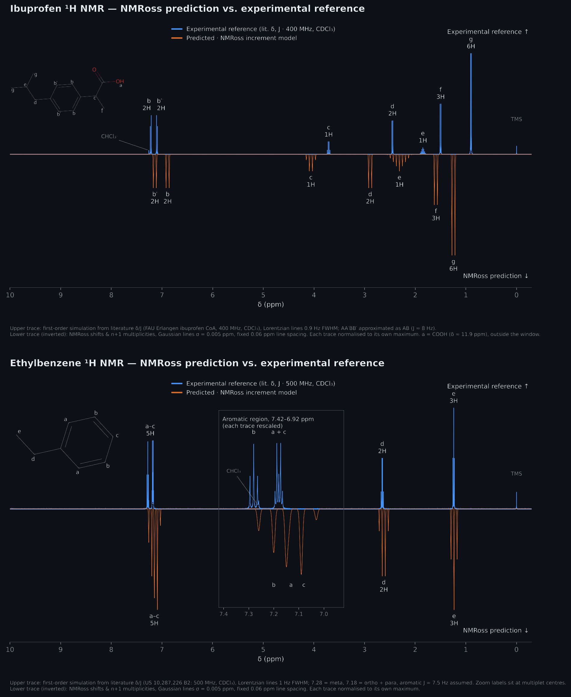

# NMRoss: a fast, rule-based ¹H NMR spectrum predictor

What does the ¹H NMR spectrum of a molecule look like? NMRoss predicts it from a name or SMILES string in under a second, using empirical substituent-increment tables and first-order (n+1) splitting rather than quantum-chemical calculations.



## Result
- Scope: molecules with at most one aromatic ring and no C=C double bonds. Carbonyls, alcohols, amines and halides are supported. Carboxylic acid O–H protons are left out, as they are broad and appear outside the increment model's range.
- Known limitation: in dialkyl ethers and on the alkoxy side of esters, the O–CH₂/O–CH₃ shift is underestimated by up to about 2 ppm (methyl acetate O–CH₃: 1.7 predicted vs 3.7 ppm experimental; diethyl ether: 2.0 predicted vs 3.5 ppm experimental; ethyl acetate: 2.3 vs 4.1 ppm). The substructure search reads these groups from the wrong side of the oxygen. Aryl ethers such as phenetole are unaffected.
- Ethylbenzene shows the textbook pattern within 0.1 ppm of experiment (CDCl₃): CH₃ triplet at 1.23 ppm (exp. 1.24), CH₂ quartet at 2.62 ppm (exp. 2.65) and aromatic multiplet at 7.09–7.20 ppm (exp. 7.15–7.30).
- The aromatic multiplicities are predicted correctly (ortho doublet, meta and para triplets) but merge into one cluster in the figure. Lines within a multiplet are drawn a fixed 0.06 ppm apart, which is 30 Hz at 500 MHz versus a real ortho coupling of about 7.5 Hz. Each multiplet is therefore wider than the gaps between the three predicted centres. The same fixed spacing makes the aliphatic multiplets look broader than in an experimental spectrum.
- For ibuprofen, every predicted shift is within 0.5 ppm of experiment. The aromatic doublets come out at 7.14 / 6.89 ppm (exp. 7.22 / 7.10) and the α-CH₃ at 1.59 ppm (exp. 1.50).

## Method
- **Input:** IUPAC name or SMILES. Names are converted to SMILES through PubChem (`pubchempy`), and the molecule is parsed with RDKit.
- **Alkyl hydrogens:** a base shift plus increments from functional groups up to four bonds away, attenuated as 1/(number of bonds)², following the increment scheme of Bell, Berry and Madigan (*Org. Magn. Reson.* 1984).
- **Aromatic hydrogens:** ortho/meta/para substituent increments added to the benzene shift.
- **Spectrum:** multiplicity from the number of neighbouring C–H hydrogens (n+1 rule), with Gaussian peaks scaled by the number of equivalent hydrogens.
- **Software:** Python ≥ 3.10, RDKit, NumPy, Matplotlib, PubChemPy. Runs on a laptop and needs no GPU.

## Repository layout
- `src/nmross/NMRoss.py`: the whole predictor. `NMR(name)` plots a spectrum, and `Show(name, index)` highlights one hydrogen's peak.
- `tests/test_NMRoss.py`: 81 pytest unit tests covering parsing, substituent search, shifts and plotting.
- `report/project_report.ipynb`: project report explaining the approximations, the algorithms and worked examples.
- `figures/`: README figure. `data/` is unused.

## How to run
```bash
pip install "nmross @ git+https://github.com/CedricRossboth/NMRoss.git"
python -c "from nmross.NMRoss import NMR; plt, mol = NMR('ibuprofen'); plt.savefig('ibuprofen.png', dpi=200, bbox_inches='tight')"
```
Expected output: `ibuprofen.png`, the right-hand spectrum shown above. An internet connection is needed, because PubChem resolves the name and supplies the plot title.

In a notebook, `NMR('CCO')` draws the spectrum of ethanol and returns `(plt, mol)`. Display `mol` to see the atom indices, then call `Show('CCO', 0)` to highlight the peak of the hydrogens on atom 0.

**From source, with tests:**
```bash
git clone https://github.com/CedricRossboth/NMRoss.git && cd NMRoss
conda create -n nmross python=3.11 -y && conda activate nmross
pip install . pytest
pytest            # 6 tests query PubChem and need internet
```
If pip fails to install RDKit on your system, run `conda install -c conda-forge rdkit` first.

## Context
CH-200 Practical Programming in Chemistry (BA4, spring 2024), Section de Chimie et Génie Chimique, EPFL. Joint project with Oscar Rosseneu; full write-up in the [report](report/project_report.ipynb).

**My contribution:** I developed the final search algorithm and implemented the logic behind the structure-search strategy. While Oscar initially explored identifying functional groups directly from SMILES strings, this led to too many ambiguous or contradictory cases. I instead developed a topology-based approach using substructure searches, which formed the basis of the final implementation. I also implemented the plotting and PubChem lookup components. We developed and tested parts of the code together, including through iterative prototyping, while the remaining code was written independently by both of us.
